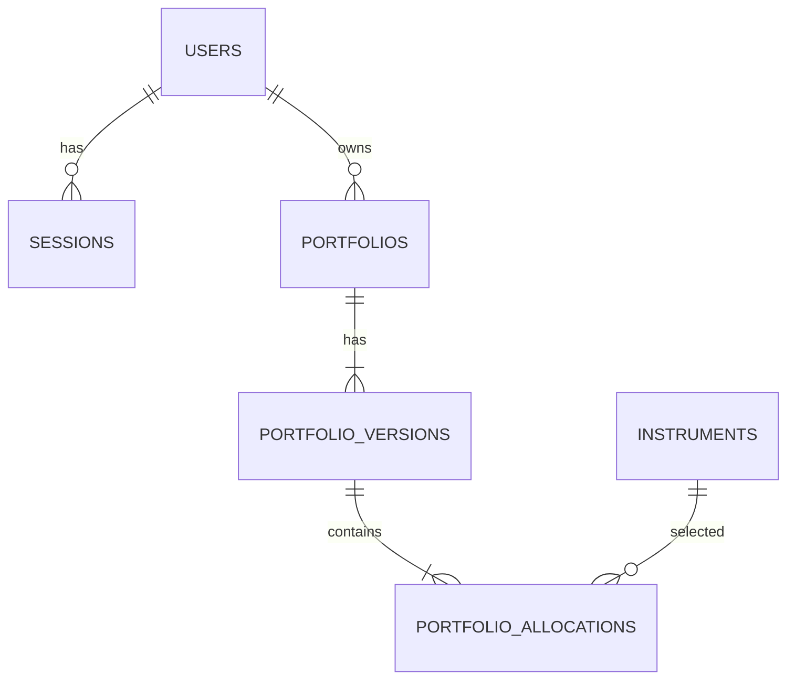

# Phạm vi và thiết kế giai đoạn 1

## Đã triển khai trong source

- FastAPI REST API dùng chung web/mobile.
- PostgreSQL qua Docker Compose; SQLAlchemy và Alembic.
- Đăng ký, đăng nhập, refresh luân phiên, đăng xuất; access token gắn với phiên trong DB.
- Mật khẩu Argon2; refresh token chỉ lưu SHA-256 vì token gốc có entropy cao.
- Danh sách tài sản mẫu AAPL/MSFT/NVDA/SPY, seed chạy lặp lại được.
- Tạo danh mục USD, tỷ trọng dương và tổng chính xác bằng 1.
- Lịch sử phân bổ bất biến; sửa cấu hình tạo version mới.
- expected_version và atomic UPDATE để xử lý sửa đồng thời.
- Đổi tên/mô tả bằng PATCH cũng tạo version mới, sao chép phân bổ cũ.
- Archive danh mục; lịch sử vẫn được giữ.
- Kiểm tra chủ sở hữu ở mọi endpoint danh mục/lịch sử.
- OpenAPI, ví dụ gọi API, smoke script và bộ kiểm thử.

## ERD

## Bảng và dữ liệu

| Bảng | Cột chính |
|---|---|
| users | id, email unique/lowercase, password_hash, display_name, created_at |
| sessions | id, user_id, client_type, refresh_token_hash, expires_at, revoked_at, created_at, rotated_at |
| instruments | id, symbol, name, exchange, asset_type, currency, provider, provider_symbol, is_active |
| portfolios | id, user_id, name, description, base_currency, current_version, created_at, updated_at, archived_at |
| portfolio_versions | id, portfolio_id, version_number, created_at |
| portfolio_allocations | portfolio_version_id + instrument_id (PK), weight NUMERIC(12,10) |

Schema chi tiết: app/models.py và migrations/versions/0001_phase_one.py. UUID dùng làm ID; thời điểm theo UTC. Khóa ngoại RESTRICT để tránh xóa mất lịch sử.

Một transaction tạo portfolio/version/allocations. Một atomic UPDATE chỉ tăng current_version nếu expected_version khớp; thất bại trả 409 và không thêm version. Không có endpoint sửa/xóa version cũ. PostgreSQL có trigger cấm UPDATE/DELETE history và deferred trigger kiểm tra tổng tỷ trọng ở lúc commit. SQLite trong test nhanh chỉ có validation API và CHECK từng dòng; không thay thế kiểm thử PostgreSQL.

Phiên bản lưu lịch sử phân bổ, chưa snapshot lịch sử tên/mô tả danh mục. Đổi tên tạo revision mới để cùng cơ chế chống ghi đè, nhưng tên ở portfolios luôn là tên hiện tại.

## Trạng thái và quy tắc

- weight ở API là chuỗi thập phân ("0.6" = 60%); không nhận số float JSON.
- Tổng bằng 1; không tự chuẩn hóa; không cho mã trùng/không tồn tại/inactive/ngoài USD.
- Danh mục archived đọc được bởi chủ sở hữu, không sửa được; archive lại là thao tác idempotent.
- Danh sách mặc định bỏ archived, phân trang limit/offset.
- Portfolio không thuộc user trả 404 để không tiết lộ tồn tại.
- Refresh token đổi sau mỗi lần dùng; token cũ bị từ chối. Phiên có hạn cố định kể từ đăng nhập, không kéo dài vô hạn.
- Replay token cũ bị từ chối; bản này chưa có cơ chế tự thu hồi toàn bộ token family khi phát hiện replay.
- Logout thu hồi phiên hiện tại; access token của phiên đó cũng bị chặn ngay nhờ tra DB.

## Chưa triển khai

Giá thị trường, return/risk, signals/factors, backtest, optimization, Studio, subscription, thanh toán, email verification, password reset, MFA, quản lý/đăng xuất các phiên khác và rate limiting phân tán. Chưa coi đây là cấu hình sẵn sàng public production; cần bổ sung chống brute force/rate limit và quy trình vận hành trước khi public.

## Trách nhiệm quản lý BE

1. Chạy README trên môi trường sạch.
2. Kiểm tra docs/openapi.json trước khi frontend nối API.
3. Duyệt migration và thay đổi contract.
4. Nghiệm thu: không truy cập chéo user, version cũ giữ tỷ trọng, cập nhật cũ trả 409, logout chặn refresh.
5. Trước khi chốt tích hợp, chạy test trên PostgreSQL thật; không dùng kết quả SQLite để kết luận trigger/concurrency PostgreSQL đã đúng.
